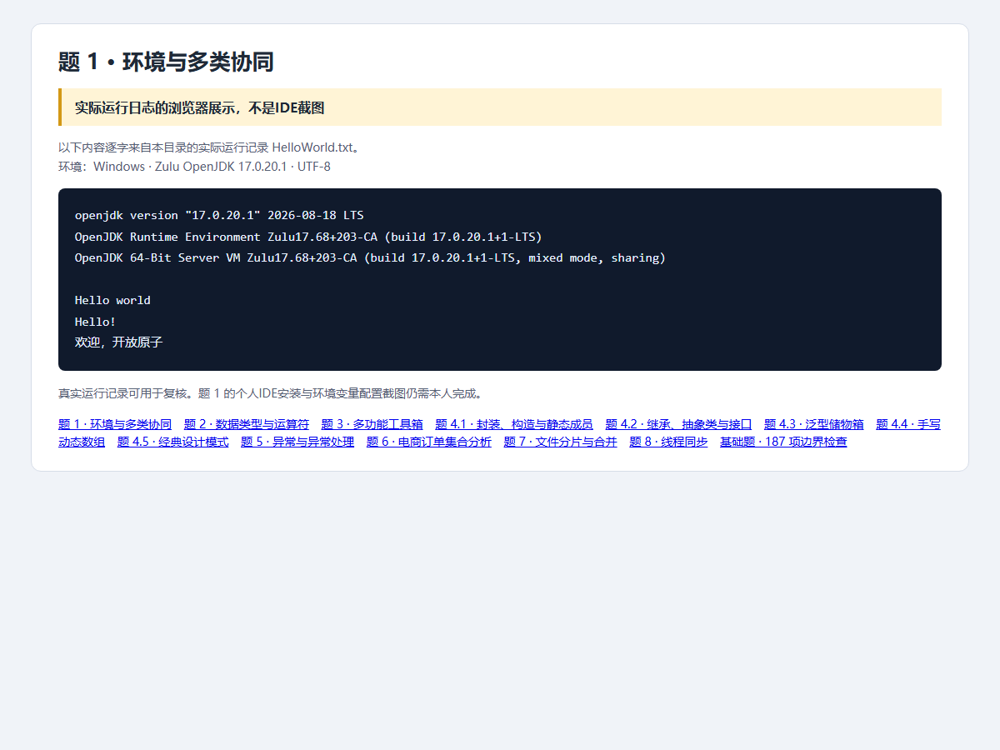

# 第1题：环境搭建与Java程序

题目要求、完整解题过程与面试追问见 [总说明](../../总说明.md)。本目录code为本题可运行源码，screenshots为截图，evidence为原始记录。


## 完整源码目录与文件

[打开本题全部代码](code/)；下面的链接直接打开源文件，不是截图。

- [GreetingService.java](code/src/openatom/basics/GreetingService.java)
- [HelloWorld.java](code/src/openatom/basics/HelloWorld.java)

## 答题过程与代码讲解

**第1步：先确定谁是程序入口。** Java启动器执行HelloWorld.main。public使入口可访问；static允许不先创建HelloWorld对象；String[]接收命令行参数。

**第2步：再把另一项职责放到另一个类。** GreetingService负责问候。new创建对象，sayHello接收字符串；所以这是跨文件的实例方法调用，不是把所有代码写进main。

**第3步：最后区分编译和运行。** javac把两个.java编成.class；java通过包名和classpath找到HelloWorld。程序输出与本机JDK/IDE配置是两项验收，不能只展示输出就声称环境要求全部完成。

## 本题完整Java源代码

以下逐文件展示实际源码，与code目录保持一致。每个文件应保持独立，不能把所有public类粘贴到同一个.java里。

### [HelloWorld.java](code/src/openatom/basics/HelloWorld.java)

```java
package openatom.basics;

public class HelloWorld {
    public static void main(String[] args) {
        System.out.println("Hello world");
        new GreetingService().sayHello("开放原子");
    }
}
```

### [GreetingService.java](code/src/openatom/basics/GreetingService.java)

```java
package openatom.basics;

public class GreetingService {
    public void sayHello(String name) {
        System.out.println("Hello!");
        System.out.println("欢迎，" + name);
    }
}
```

## 运行

需要JDK17。在本题目录执行：

```powershell
./code/run.ps1 -Main HelloWorld
```

Linux/macOS可在本题目录执行：

```sh
mkdir -p build/classes
javac -encoding UTF-8 --release 17 -d build/classes code/src/openatom/basics/*.java
java -Dfile.encoding=UTF-8 -cp build/classes openatom.basics.HelloWorld
```

## 证据来源与完成状态

截图是Java实际运行日志的浏览器展示，不是IDE截图；187项基础检查已复验。个人JAVA_HOME/Path、版本和IDE截图仍待补。



