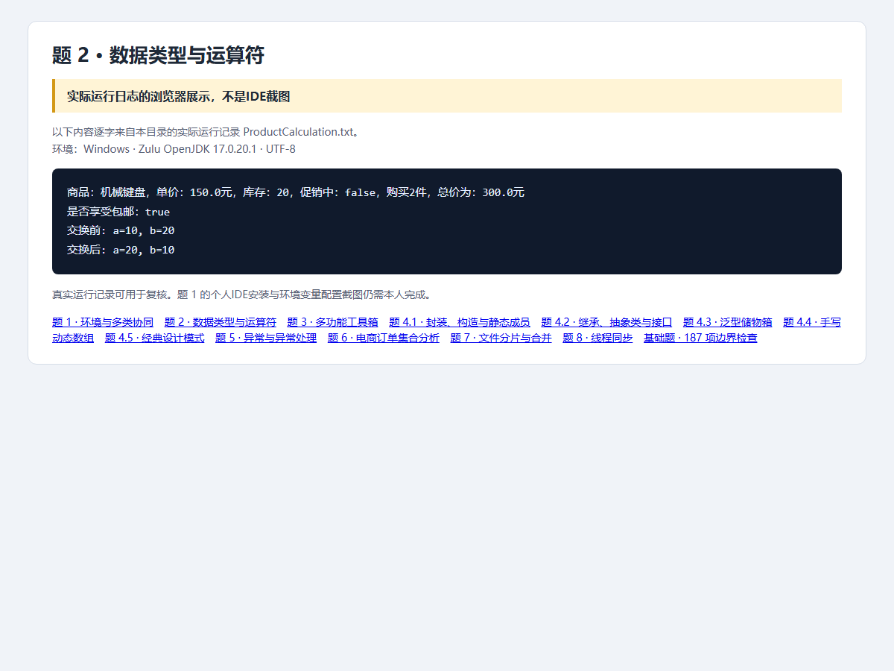

# 第2题：数据类型与运算符

题目要求、完整解题过程与面试追问见 [总说明](../../总说明.md)。本目录src为唯一源码，screenshots为截图，evidence为本题记录。


## 源码目录与文件

[打开源码目录](src)；下面的链接直接打开源文件，不是截图。

- [ProductCalculation.java](src/openatom/basics/ProductCalculation.java)

## 答题过程与代码讲解

**第1步：先建模，再算钱。** name、price、stock、promotional、quantity分别表达业务数据。total=150×2=300。当前样例只展示库存，不实现库存扣减或超库存购买拒绝。

**第2步：把文字规则转成布尔表达式。** “满100或促销”就是total>=100 || promotional。这里300>=100为true，即使promotional=false也包邮；不能误写成&&。

**第3步：手算三步异或。** 初始a=10、b=20。a^=b后a=30；b^=a后b=10；a^=b后a=20。三行有先后依赖，不能随意改顺序。

## 本题完整Java源代码

以下逐文件展示实际源码，与源码目录保持一致。每个文件应保持独立，不能把所有public类粘贴到同一个.java里。

### [ProductCalculation.java](src/openatom/basics/ProductCalculation.java)

```java
package openatom.basics;

public class ProductCalculation {
    public static void main(String[] args) {
        String name = "机械键盘";
        double price = 150.0;
        int stock = 20;
        boolean promotional = false;
        int quantity = 2;
        double total = price * quantity;
        boolean freeShipping = total >= 100 || promotional;
        System.out.println("商品：" + name + "，单价：" + price + "元，库存：" + stock
                + "，促销中：" + promotional + "，购买" + quantity + "件，总价为：" + total + "元");
        System.out.println("是否享受包邮：" + freeShipping);
        int a = 10, b = 20;
        System.out.println("交换前: a=" + a + ", b=" + b);
        // 两个独立变量可用 XOR 交换，不存在加减法交换的整数溢出问题。
        a ^= b;
        b ^= a;
        a ^= b;
        System.out.println("交换后: a=" + a + ", b=" + b);
    }
}
```

## 运行

需要JDK17。在本题目录执行：

```powershell
../../scripts/run-basics.ps1 -Main ProductCalculation
```

Linux/macOS可在本题目录执行：

```sh
mkdir -p build/classes
javac -encoding UTF-8 --release 17 -d build/classes src/openatom/basics/*.java
java -Dfile.encoding=UTF-8 -cp build/classes openatom.basics.ProductCalculation
```

## 证据来源与完成状态

截图是Java实际运行日志的浏览器展示，不是IDE截图；187项基础检查已复验。



