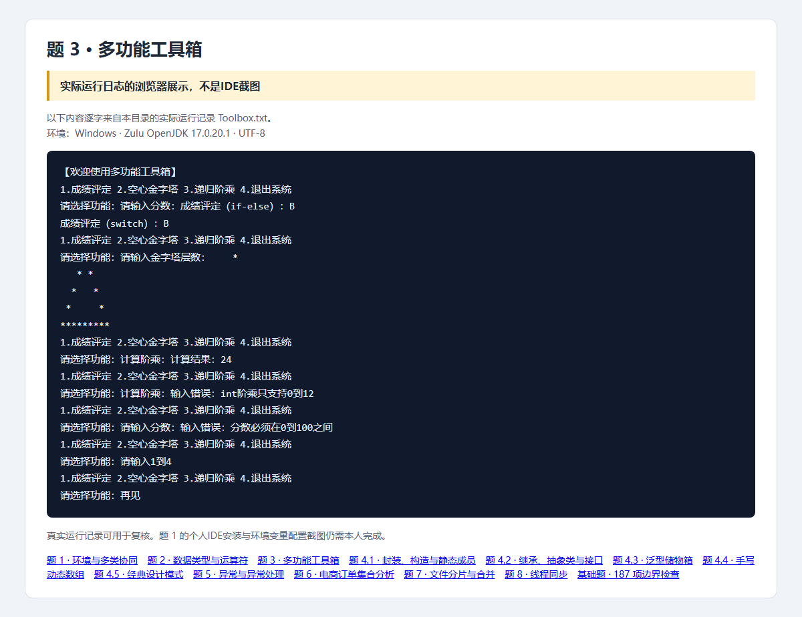

# 第3题：控制流工具箱

题目要求、完整解题过程与面试追问见 [总说明](../../总说明.md)。本目录src为唯一源码，screenshots为截图，evidence为本题记录。


## 源码目录与文件

[打开源码目录](src)；下面的链接直接打开源文件，不是截图。

- [Toolbox.java](src/openatom/basics/Toolbox.java)

## 答题过程与代码讲解

**第1步：先写菜单循环。** while(true)保持交互，4在外层直接break；其他错误菜单continue，进入下一轮。读取整行再parseInt，避免混用nextInt/nextLine留下换行。

**第2步：同一分数跑两种判断。** 86先落到if的>=80，得到B；86/10=8，所以switch的case8同样B。100/10=10也必须得到A。先限制0—100再判断，避免负数默认被判E。

**第3步：把图形变成坐标条件。** h=5、row=3时前导空格为2，图形宽度为5。col=1和5打印星，其余三个位置空白；最后一行全部打印星。

**第4步：展开递归。** 4!调用链是4×factorial(3)→4×3×factorial(2)→4×3×2×factorial(1)，返回24。0/1是停止条件；n>12在计算前拒绝，避免int溢出。

## 本题完整Java源代码

以下逐文件展示实际源码，与源码目录保持一致。每个文件应保持独立，不能把所有public类粘贴到同一个.java里。

### [Toolbox.java](src/openatom/basics/Toolbox.java)

```java
package openatom.basics;

import java.util.Scanner;

public class Toolbox {
    public static String gradeIf(int score) {
        checkScore(score);
        if (score >= 90) return "A";
        else if (score >= 80) return "B";
        else if (score >= 70) return "C";
        else if (score >= 60) return "D";
        else return "E";
    }

    public static String gradeSwitch(int score) {
        checkScore(score);
        switch (score / 10) {
            case 10: case 9: return "A";
            case 8: return "B";
            case 7: return "C";
            case 6: return "D";
            default: return "E";
        }
    }

    private static void checkScore(int score) {
        if (score < 0 || score > 100) throw new IllegalArgumentException("分数必须在0到100之间");
    }

    public static String pyramid(int levels) {
        if (levels < 1 || levels > 100) throw new IllegalArgumentException("层数必须在1到100之间");
        StringBuilder result = new StringBuilder();
        for (int row = 1; row <= levels; row++) {
            for (int space = 0; space < levels - row; space++) result.append(' ');
            for (int col = 1; col <= 2 * row - 1; col++) {
                result.append(row == 1 || row == levels || col == 1 || col == 2 * row - 1 ? '*' : ' ');
            }
            result.append(System.lineSeparator());
        }
        return result.toString();
    }

    public int calculateFactorial(int n) {
        // 题目指定 int 返回值，13! 已溢出，因此明确限制而不是返回错误结果。
        if (n < 0 || n > 12) throw new IllegalArgumentException("int阶乘只支持0到12");
        return n <= 1 ? 1 : n * calculateFactorial(n - 1);
    }

    public static void main(String[] args) {
        Toolbox toolbox = new Toolbox();
        try (Scanner scanner = new Scanner(System.in)) {
            System.out.println("【欢迎使用多功能工具箱】");
            while (true) {
                System.out.println("1.成绩评定 2.空心金字塔 3.递归阶乘 4.退出系统");
                System.out.print("请选择功能：");
                if (!scanner.hasNextLine()) break;
                String selection = scanner.nextLine().trim();
                if (selection.equals("4")) { System.out.println("再见"); break; }
                if (!selection.matches("[123]")) { System.out.println("请输入1到4"); continue; }
                System.out.print(selection.equals("1") ? "请输入分数：" : selection.equals("2") ? "请输入金字塔层数：" : "计算阶乘：");
                if (!scanner.hasNextLine()) break;
                try {
                    int input = Integer.parseInt(scanner.nextLine().trim());
                    switch (selection) {
                        case "1":
                            System.out.println("成绩评定（if-else）：" + gradeIf(input));
                            System.out.println("成绩评定（switch）：" + gradeSwitch(input)); break;
                        case "2": System.out.print(pyramid(input)); break;
                        case "3": System.out.println("计算结果：" + toolbox.calculateFactorial(input)); break;
                        default: break;
                    }
                } catch (IllegalArgumentException exception) {
                    System.out.println("输入错误：" + exception.getMessage());
                }
            }
        }
    }
}
```

## 运行

需要JDK17。在本题目录执行：

```powershell
../../scripts/run-basics.ps1 -Main Toolbox
```

Linux/macOS可在本题目录执行：

```sh
mkdir -p build/classes
javac -encoding UTF-8 --release 17 -d build/classes src/openatom/basics/*.java
java -Dfile.encoding=UTF-8 -cp build/classes openatom.basics.Toolbox
```

## 证据来源与完成状态

截图是Java实际运行日志的浏览器展示，不是IDE截图；187项基础检查已复验。



