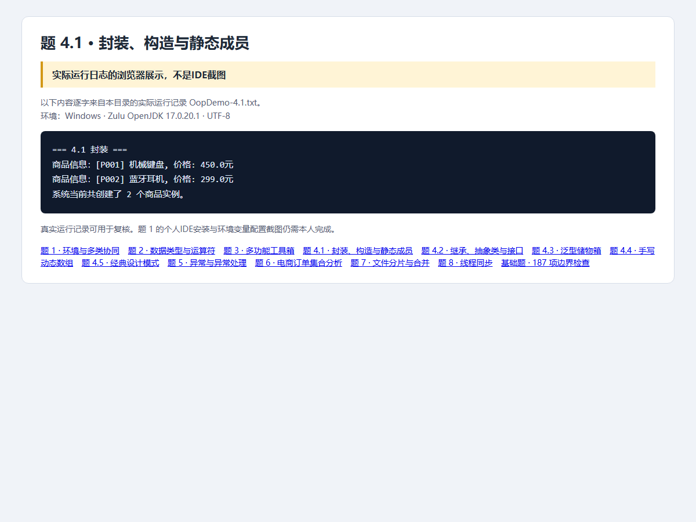
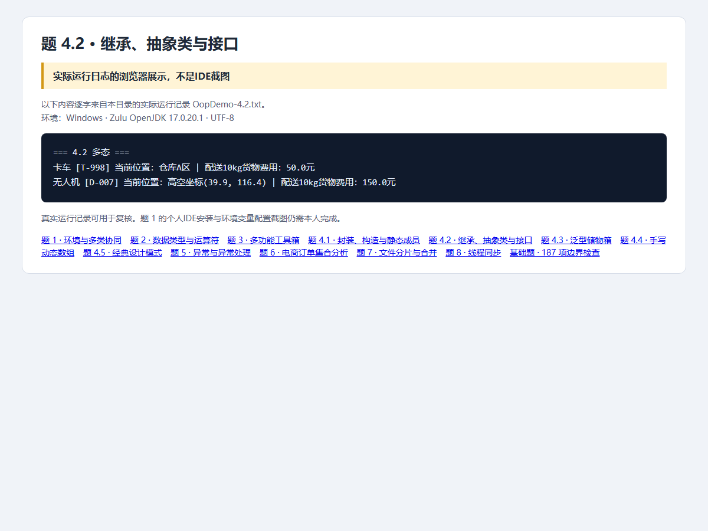
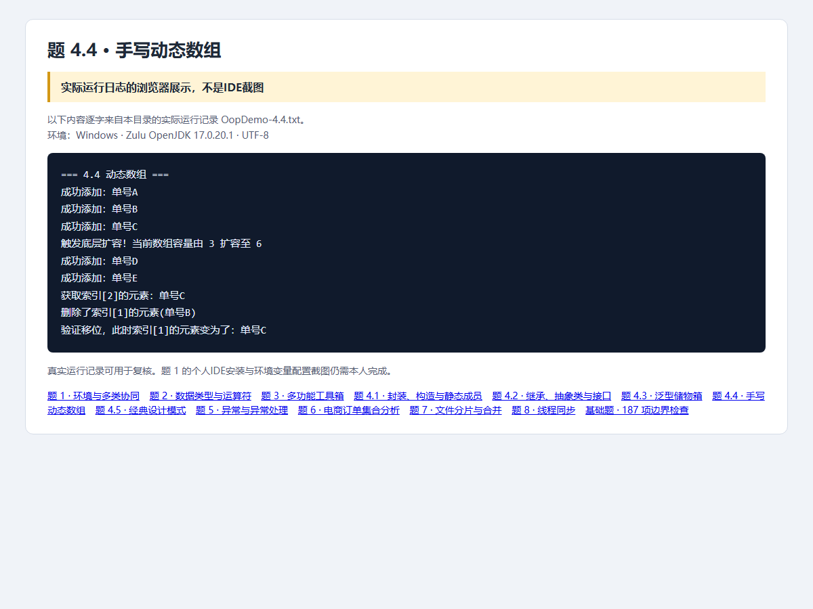
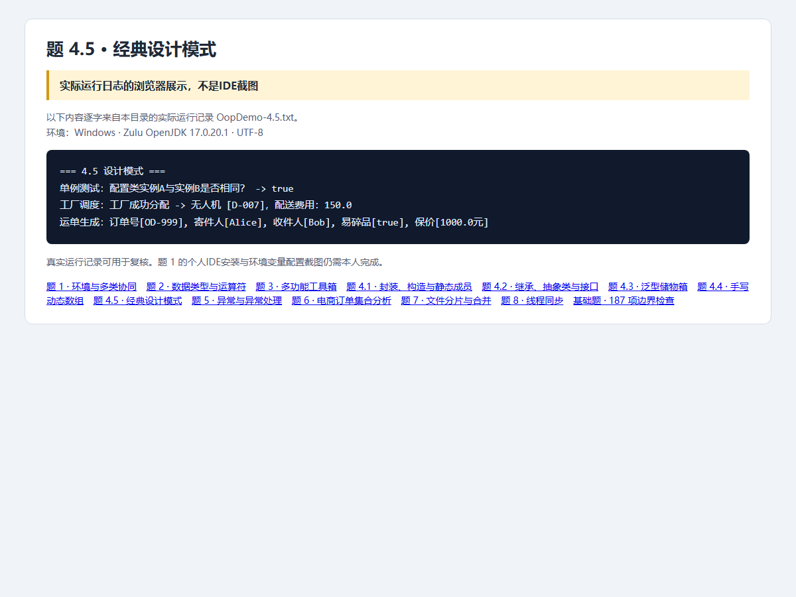

# 第4题：面向对象与设计模式

题目要求、完整解题过程与面试追问见 [总说明](../../总说明.md)。本目录src为唯一源码，screenshots为截图，evidence为本题记录。


## 源码目录与文件

[打开源码目录](src)；下面的链接直接打开源文件，不是截图。

- [Drone.java](src/openatom/basics/Drone.java)
- [GPSLocatable.java](src/openatom/basics/GPSLocatable.java)
- [LogisticsConfig.java](src/openatom/basics/LogisticsConfig.java)
- [LogisticsOrder.java](src/openatom/basics/LogisticsOrder.java)
- [MyArrayList.java](src/openatom/basics/MyArrayList.java)
- [OopDemo.java](src/openatom/basics/OopDemo.java)
- [Product.java](src/openatom/basics/Product.java)
- [StorageBox.java](src/openatom/basics/StorageBox.java)
- [TransportVehicle.java](src/openatom/basics/TransportVehicle.java)
- [Truck.java](src/openatom/basics/Truck.java)
- [VehicleFactory.java](src/openatom/basics/VehicleFactory.java)

## 答题过程与代码讲解

**第1步：4.1：从对象数据开始。** Product的private字段只能通过受控方法访问。无参构造this(...)委托全参构造，所以计数只在全参构造累加一次；new两个对象总数为2。

**第2步：4.2：用不同对象实现同一种调用。** TransportVehicle定义共同编号与calculateCost。父类引用指向Truck/Drone时，10kg分别执行各自实现，得到50/150；定位能力由GPSLocatable接口表达。

**第3步：4.3：让错误在编译时暴露。** StorageBox<Product>只能接收Product；StorageBox<TransportVehicle>可接收Drone。T同时约束入参与返回值，取出后无需把Object强制转为Product。

**第4步：4.4：跟踪每个数组格子。** 添加A/B/C后size=3、capacity=3；加D前创建6格新数组并复制，加E后size=5。删除index1的B，把C/D/E左移，结果[A,C,D,E,null,null]，size=4，capacity仍6。

**第5步：4.5：按问题选择模式。** 配置用饿汉单例；车辆类型选择集中在工厂；订单用Builder设置可选项。Builder每个方法return this才能继续链式调用，build复制值到final字段形成快照。

## 本题完整Java源代码

以下逐文件展示实际源码，与源码目录保持一致。每个文件应保持独立，不能把所有public类粘贴到同一个.java里。

### [Product.java](src/openatom/basics/Product.java)

```java
package openatom.basics;

public class Product {
    private String id;
    private String name;
    private double price;
    private static int totalProductCount;

    public Product() { this("未编号", "未命名", 0); }
    public Product(String id, String name, double price) {
        setId(id); setName(name); setPrice(price);
        totalProductCount++;
    }
    public String getId() { return id; }
    public void setId(String id) {
        if (id == null || id.isBlank()) throw new IllegalArgumentException("商品编号不能为空");
        this.id = id;
    }
    public String getName() { return name; }
    public void setName(String name) {
        if (name == null || name.isBlank()) throw new IllegalArgumentException("商品名称不能为空");
        this.name = name;
    }
    public double getPrice() { return price; }
    public void setPrice(double price) {
        if (!Double.isFinite(price) || price < 0) throw new IllegalArgumentException("价格必须为有限非负数");
        this.price = price;
    }
    public static int getTotalCount() { return totalProductCount; }
    public void printInfo() { System.out.println("商品信息：[" + id + "] " + name + ", 价格: " + price + "元"); }
}
```

### [GPSLocatable.java](src/openatom/basics/GPSLocatable.java)

```java
package openatom.basics;
public interface GPSLocatable { String getLocation(); }
```

### [TransportVehicle.java](src/openatom/basics/TransportVehicle.java)

```java
package openatom.basics;
public abstract class TransportVehicle {
    protected String vehicleId;
    public TransportVehicle(String vehicleId) {
        if (vehicleId == null || vehicleId.isBlank()) throw new IllegalArgumentException("车辆编号不能为空");
        this.vehicleId = vehicleId;
    }
    public String getVehicleId() { return vehicleId; }
    public abstract double calculateCost(double weight);
    protected void validateWeight(double weight) {
        if (!Double.isFinite(weight) || weight < 0) throw new IllegalArgumentException("重量必须为有限非负数");
    }
}
```

### [Truck.java](src/openatom/basics/Truck.java)

```java
package openatom.basics;
public class Truck extends TransportVehicle implements GPSLocatable {
    public Truck(String id) { super(id); }
    @Override public double calculateCost(double weight) { validateWeight(weight); return weight * 5.0; }
    @Override public String getLocation() { return "仓库A区"; }
    @Override public String toString() { return "卡车 [" + vehicleId + "]"; }
}
```

### [Drone.java](src/openatom/basics/Drone.java)

```java
package openatom.basics;
public class Drone extends TransportVehicle implements GPSLocatable {
    public Drone(String id) { super(id); }
    @Override public double calculateCost(double weight) { validateWeight(weight); return weight * 15.0; }
    @Override public String getLocation() { return "高空坐标(39.9, 116.4)"; }
    @Override public String toString() { return "无人机 [" + vehicleId + "]"; }
}
```

### [StorageBox.java](src/openatom/basics/StorageBox.java)

```java
package openatom.basics;
public class StorageBox<T> {
    private T item;
    public void storeItem(T item) { this.item = item; }
    public T retrieveItem() { return item; }
}
```

### [MyArrayList.java](src/openatom/basics/MyArrayList.java)

```java
package openatom.basics;
public class MyArrayList<T> {
    private Object[] elements;
    private int size;
    public MyArrayList() { elements = new Object[3]; }
    public void add(T element) {
        if (size == elements.length) {
            Object[] expanded = new Object[elements.length * 2];
            for (int i = 0; i < size; i++) expanded[i] = elements[i];
            System.out.println("触发底层扩容！当前数组容量由 " + elements.length + " 扩容至 " + expanded.length);
            elements = expanded;
        }
        elements[size++] = element;
        System.out.println("成功添加：" + element);
    }
    @SuppressWarnings("unchecked")
    public T get(int index) {
        if (!validIndex(index)) return null;
        return (T) elements[index];
    }
    public void remove(int index) {
        if (!validIndex(index)) return;
        Object removed = elements[index];
        for (int i = index; i < size - 1; i++) elements[i] = elements[i + 1];
        elements[--size] = null;
        System.out.println("删除了索引[" + index + "]的元素(" + removed + ")");
    }
    private boolean validIndex(int index) {
        if (index < 0 || index >= size) { System.out.println("索引越界：" + index + "，当前元素数量：" + size); return false; }
        return true;
    }
    public int size() { return size; }
    public int capacity() { return elements.length; }
}
```

### [LogisticsConfig.java](src/openatom/basics/LogisticsConfig.java)

```java
package openatom.basics;
public final class LogisticsConfig {
    private String systemName = "顺风智能仓储系统";
    private static final LogisticsConfig INSTANCE = new LogisticsConfig();
    private LogisticsConfig() { }
    public static LogisticsConfig getInstance() { return INSTANCE; }
    public String getSystemName() { return systemName; }
}
```

### [VehicleFactory.java](src/openatom/basics/VehicleFactory.java)

```java
package openatom.basics;
public final class VehicleFactory {
    private VehicleFactory() { }
    public static TransportVehicle createVehicle(String type) {
        if ("Truck".equals(type)) return new Truck("T-998");
        if ("Drone".equals(type)) return new Drone("D-007");
        return null;
    }
}
```

### [LogisticsOrder.java](src/openatom/basics/LogisticsOrder.java)

```java
package openatom.basics;
public final class LogisticsOrder {
    private final String orderId;
    private final String sender;
    private final String recipient;
    private final boolean fragile;
    private final double insuredAmount;
    private LogisticsOrder(Builder builder) {
        orderId = builder.orderId; sender = builder.sender; recipient = builder.recipient;
        fragile = builder.fragile; insuredAmount = builder.insuredAmount;
    }
    public static class Builder {
        private final String orderId;
        private String sender = "未填写";
        private String recipient = "未填写";
        private boolean fragile;
        private double insuredAmount;
        public Builder(String orderId) {
            if (orderId == null || orderId.isBlank()) throw new IllegalArgumentException("订单号必填");
            this.orderId = orderId;
        }
        public Builder sender(String sender) { this.sender = sender; return this; }
        public Builder recipient(String recipient) { this.recipient = recipient; return this; }
        public Builder fragile(boolean fragile) { this.fragile = fragile; return this; }
        public Builder insuredAmount(double amount) {
            if (!Double.isFinite(amount) || amount < 0) throw new IllegalArgumentException("保价金额必须为有限非负数");
            insuredAmount = amount; return this;
        }
        public LogisticsOrder build() { return new LogisticsOrder(this); }
    }
    @Override public String toString() {
        return "订单号[" + orderId + "], 寄件人[" + sender + "], 收件人[" + recipient
                + "], 易碎品[" + fragile + "], 保价[" + insuredAmount + "元]";
    }
}
```

### [OopDemo.java](src/openatom/basics/OopDemo.java)

```java
package openatom.basics;
public class OopDemo {
    public static void main(String[] args) {
        String task = args.length == 0 ? "all" : args[0];
        if (task.equals("all") || task.equals("4.1")) productDemo();
        if (task.equals("all") || task.equals("4.2")) vehicleDemo();
        if (task.equals("all") || task.equals("4.3")) storageDemo();
        if (task.equals("all") || task.equals("4.4")) arrayDemo();
        if (task.equals("all") || task.equals("4.5")) patternsDemo();
    }
    private static void productDemo() {
        System.out.println("=== 4.1 封装 ===");
        Product first = new Product("P001", "机械键盘", 450);
        Product second = new Product();
        second.setId("P002"); second.setName("蓝牙耳机"); second.setPrice(299);
        first.printInfo(); second.printInfo();
        System.out.println("系统当前共创建了 " + Product.getTotalCount() + " 个商品实例。");
    }
    private static void vehicleDemo() {
        System.out.println("=== 4.2 多态 ===");
        TransportVehicle[] vehicles = {new Truck("T-998"), new Drone("D-007")};
        for (TransportVehicle vehicle : vehicles) {
            GPSLocatable gps = (GPSLocatable) vehicle;
            System.out.println(vehicle + " 当前位置：" + gps.getLocation() + " | 配送10kg货物费用：" + vehicle.calculateCost(10) + "元");
        }
    }
    private static void storageDemo() {
        System.out.println("=== 4.3 泛型储物箱 ===");
        StorageBox<Product> products = new StorageBox<>();
        products.storeItem(new Product("P001", "机械键盘", 450));
        Product product = products.retrieveItem();
        System.out.println("商品储物箱存取测试：成功取出商品 -> " + product.getName());
        StorageBox<TransportVehicle> vehicles = new StorageBox<>();
        vehicles.storeItem(new Drone("D-007"));
        TransportVehicle vehicle = vehicles.retrieveItem();
        System.out.println("设备储物箱存取测试：成功取出设备 -> " + vehicle);
    }
    private static void arrayDemo() {
        System.out.println("=== 4.4 动态数组 ===");
        MyArrayList<String> packages = new MyArrayList<>();
        for (String id : new String[]{"单号A", "单号B", "单号C", "单号D", "单号E"}) packages.add(id);
        System.out.println("获取索引[2]的元素：" + packages.get(2));
        packages.remove(1);
        System.out.println("验证移位，此时索引[1]的元素变为了：" + packages.get(1));
    }
    private static void patternsDemo() {
        System.out.println("=== 4.5 设计模式 ===");
        System.out.println("单例测试：配置类实例A与实例B是否相同？ -> " + (LogisticsConfig.getInstance() == LogisticsConfig.getInstance()));
        TransportVehicle vehicle = VehicleFactory.createVehicle("Drone");
        System.out.println("工厂调度：工厂成功分配 -> " + vehicle + "，配送费用：" + vehicle.calculateCost(10));
        LogisticsOrder order = new LogisticsOrder.Builder("OD-999").sender("Alice").recipient("Bob").fragile(true).insuredAmount(1000).build();
        System.out.println("运单生成：" + order);
    }
}
```

## 运行

需要JDK17。在本题目录执行：

```powershell
../../scripts/run-basics.ps1 -Main OopDemo
```

分子题运行可另加 `-ProgramArgs 4.1`，依次替换为4.2—4.5。

Linux/macOS可在本题目录执行：

```sh
mkdir -p build/classes
javac -encoding UTF-8 --release 17 -d build/classes src/openatom/basics/*.java
java -Dfile.encoding=UTF-8 -cp build/classes openatom.basics.OopDemo
```

## 证据来源与完成状态

截图是Java实际运行日志的浏览器展示，不是IDE截图；187项基础检查已复验。










