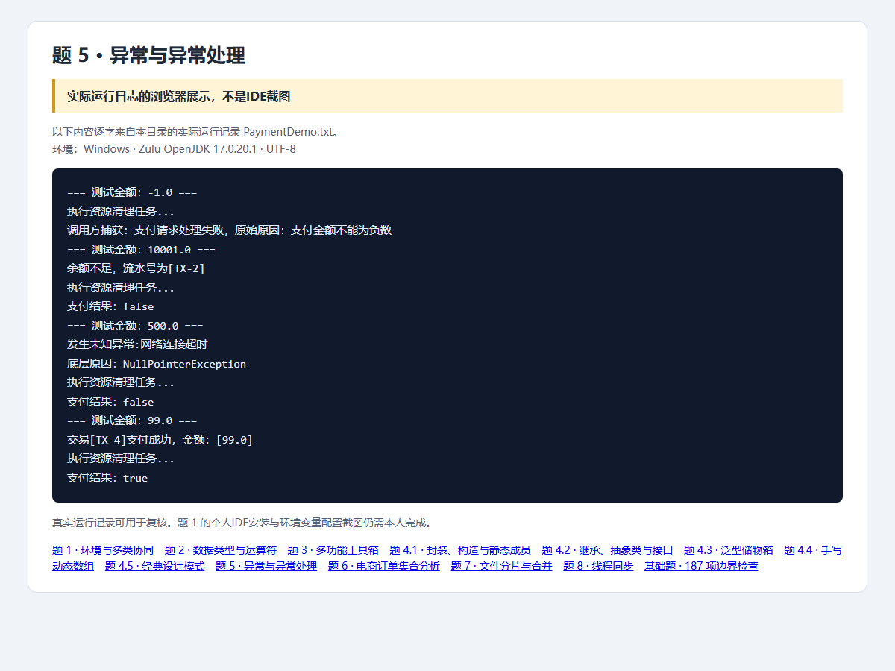

# 第5题：异常处理支付网关

题目要求、完整解题过程与面试追问见 [总说明](../../总说明.md)。本目录code为本题可运行源码，screenshots为截图，evidence为原始记录。


## 完整源码目录与文件

[打开本题全部代码](code/)；下面的链接直接打开源文件，不是截图。

- [InsufficientFundsException.java](code/src/openatom/basics/InsufficientFundsException.java)
- [PaymentDemo.java](code/src/openatom/basics/PaymentDemo.java)
- [PaymentProcessor.java](code/src/openatom/basics/PaymentProcessor.java)
- [PaymentService.java](code/src/openatom/basics/PaymentService.java)
- [SystemMaintenanceException.java](code/src/openatom/basics/SystemMaintenanceException.java)

## 答题过程与代码讲解

**第1步：先明确异常出现在哪层。** PaymentProcessor判断金额并抛异常；PaymentService决定如何处理；PaymentDemo是最后防止演示中断的调用方。

**第2步：逐项推演四个输入。** 负数：Processor抛IllegalArgumentException→Service包装并重抛SystemMaintenanceException→finally→main捕获。大于10000：受检余额异常→Service打印流水号、返回false，同时finally执行。500：维护异常带NullPointerException原因→其他catch返回false，同时finally执行。正常值：打印成功、返回true，同时finally执行。

**第3步：解释异常链。** 包装时把原异常作为cause，而不是只复制message。这样main或日志仍可查到真实底层原因。finally里只有清理打印，没有return，避免覆盖结果或吞异常。

## 本题完整Java源代码

以下逐文件展示实际源码，与code目录保持一致。每个文件应保持独立，不能把所有public类粘贴到同一个.java里。

### [InsufficientFundsException.java](code/src/openatom/basics/InsufficientFundsException.java)

```java
package openatom.basics;
public class InsufficientFundsException extends Exception {
    private static final long serialVersionUID = 1L;
    private final String transactionId;
    public InsufficientFundsException(String message, String transactionId) { super(message); this.transactionId = transactionId; }
    public String getTransactionId() { return transactionId; }
}
```

### [SystemMaintenanceException.java](code/src/openatom/basics/SystemMaintenanceException.java)

```java
package openatom.basics;
public class SystemMaintenanceException extends RuntimeException {
    private static final long serialVersionUID = 1L;
    public SystemMaintenanceException(String message, Throwable cause) { super(message, cause); }
}
```

### [PaymentProcessor.java](code/src/openatom/basics/PaymentProcessor.java)

```java
package openatom.basics;
public class PaymentProcessor {
    public void pay(double amount, String transactionId) throws InsufficientFundsException {
        if (!Double.isFinite(amount)) throw new IllegalArgumentException("支付金额必须为有限数值");
        if (amount < 0) throw new IllegalArgumentException("支付金额不能为负数");
        if (amount > 10000) throw new InsufficientFundsException("余额不足", transactionId);
        if (amount == 500) throw new SystemMaintenanceException("网络连接超时", new NullPointerException("模拟底层连接对象为空"));
        System.out.println("交易[" + transactionId + "]支付成功，金额：[" + amount + "]");
    }
}
```

### [PaymentService.java](code/src/openatom/basics/PaymentService.java)

```java
package openatom.basics;
public class PaymentService {
    public boolean pay(double amount, String transactionId) {
        try {
            new PaymentProcessor().pay(amount, transactionId);
            return true;
        } catch (InsufficientFundsException exception) {
            System.out.println("余额不足，流水号为[" + exception.getTransactionId() + "]");
            return false;
        } catch (IllegalArgumentException exception) {
            throw new SystemMaintenanceException("支付请求处理失败", exception);
        } catch (Exception exception) {
            System.out.println("发生未知异常:" + exception.getMessage());
            System.out.println("底层原因：" + (exception.getCause() == null ? "无" : exception.getCause().getClass().getSimpleName()));
            return false;
        } finally {
            System.out.println("执行资源清理任务...");
        }
    }
}
```

### [PaymentDemo.java](code/src/openatom/basics/PaymentDemo.java)

```java
package openatom.basics;
public class PaymentDemo {
    public static void main(String[] args) {
        PaymentService service = new PaymentService();
        double[] amounts = {-1, 10001, 500, 99};
        for (int i = 0; i < amounts.length; i++) {
            System.out.println("=== 测试金额：" + amounts[i] + " ===");
            try { System.out.println("支付结果：" + service.pay(amounts[i], "TX-" + (i + 1))); }
            catch (SystemMaintenanceException exception) {
                System.out.println("调用方捕获：" + exception.getMessage() + "，原始原因：" + exception.getCause().getMessage());
            }
        }
    }
}
```

## 运行

需要JDK17。在本题目录执行：

```powershell
./code/run.ps1 -Main PaymentDemo
```

Linux/macOS可在本题目录执行：

```sh
mkdir -p build/classes
javac -encoding UTF-8 --release 17 -d build/classes code/src/openatom/basics/*.java
java -Dfile.encoding=UTF-8 -cp build/classes openatom.basics.PaymentDemo
```

## 证据来源与完成状态

截图是Java实际运行日志的浏览器展示，不是IDE截图；187项基础检查已复验。



