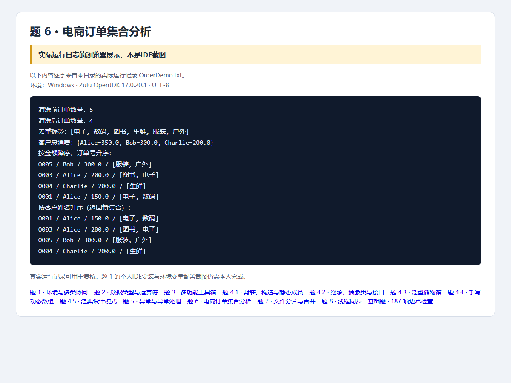

# 第6题：集合订单分析

题目要求、完整解题过程与面试追问见 [总说明](../../总说明.md)。本目录src为唯一源码，screenshots为截图，evidence为本题记录。


## 源码目录与文件

[打开源码目录](src)；下面的链接直接打开源文件，不是截图。

- [Order.java](src/openatom/basics/Order.java)
- [OrderAnalyzer.java](src/openatom/basics/OrderAnalyzer.java)
- [OrderDemo.java](src/openatom/basics/OrderDemo.java)

## 答题过程与代码讲解

**第1步：先装入原题五条数据。** OrderAnalyzer保存List<Order>，O002为-50，是要删除的无效订单。必须先清洗再报表，不能让Bob的负单参与累计。

**第2步：分别解决去重与分组。** 标签逐个加入LinkedHashSet，相同“电子”只保留一次；spending.merge把同名客户金额累计，Alice=150+200=350、Bob=300、Charlie=200。

**第3步：区分两种排序。** 默认Comparable先金额降序，同金额再订单号升序，因此O005、O003、O004、O001；姓名排序使用Comparator，先复制List再排，不改变原始容器顺序。

## 本题完整Java源代码

以下逐文件展示实际源码，与源码目录保持一致。每个文件应保持独立，不能把所有public类粘贴到同一个.java里。

### [Order.java](src/openatom/basics/Order.java)

```java
package openatom.basics;
import java.util.List;
public final class Order implements Comparable<Order> {
    private final String orderId;
    private final String customerName;
    private final double amount;
    private final List<String> tags;
    public Order(String orderId, String customerName, double amount, List<String> tags) {
        if (orderId == null || customerName == null || !Double.isFinite(amount)) throw new IllegalArgumentException("订单字段无效");
        this.orderId = orderId; this.customerName = customerName; this.amount = amount; this.tags = List.copyOf(tags);
    }
    public String getOrderId() { return orderId; }
    public String getCustomerName() { return customerName; }
    public double getAmount() { return amount; }
    public List<String> getTags() { return tags; }
    @Override public int compareTo(Order other) {
        int byAmount = Double.compare(other.amount, amount);
        return byAmount != 0 ? byAmount : orderId.compareTo(other.orderId);
    }
    @Override public String toString() { return orderId + " / " + customerName + " / " + amount + " / " + tags; }
}
```

### [OrderAnalyzer.java](src/openatom/basics/OrderAnalyzer.java)

```java
package openatom.basics;
import java.util.*;
public class OrderAnalyzer {
    private final List<Order> orders = new ArrayList<>();
    public void add(Order order) { orders.add(Objects.requireNonNull(order, "订单不能为空")); }
    public void removeInvalidOrders() { orders.removeIf(order -> order.getAmount() <= 0); }
    public Set<String> getAllUniqueTags() {
        Set<String> tags = new LinkedHashSet<>();
        for (Order order : orders) tags.addAll(order.getTags());
        return tags;
    }
    public Map<String, Double> getCustomerSpendMap() {
        Map<String, Double> spending = new TreeMap<>();
        for (Order order : orders) spending.merge(order.getCustomerName(), order.getAmount(), Double::sum);
        return spending;
    }
    public List<Order> sortOrdersByCustomerName() {
        List<Order> sorted = new ArrayList<>(orders);
        sorted.sort(Comparator.comparing(Order::getCustomerName).thenComparing(Order::getOrderId));
        return sorted;
    }
    public List<Order> sortedByAmount() { List<Order> result = new ArrayList<>(orders); Collections.sort(result); return result; }
    public int size() { return orders.size(); }
}
```

### [OrderDemo.java](src/openatom/basics/OrderDemo.java)

```java
package openatom.basics;
import java.util.List;
public class OrderDemo {
    public static void main(String[] args) {
        OrderAnalyzer analyzer = sample();
        System.out.println("清洗前订单数量：" + analyzer.size());
        analyzer.removeInvalidOrders();
        System.out.println("清洗后订单数量：" + analyzer.size());
        System.out.println("去重标签：" + analyzer.getAllUniqueTags());
        System.out.println("客户总消费：" + analyzer.getCustomerSpendMap());
        System.out.println("按金额降序、订单号升序："); analyzer.sortedByAmount().forEach(System.out::println);
        System.out.println("按客户姓名升序（返回新集合）："); analyzer.sortOrdersByCustomerName().forEach(System.out::println);
    }
    public static OrderAnalyzer sample() {
        OrderAnalyzer a = new OrderAnalyzer();
        a.add(new Order("O001", "Alice", 150, List.of("电子", "数码")));
        a.add(new Order("O002", "Bob", -50, List.of("服装")));
        a.add(new Order("O003", "Alice", 200, List.of("图书", "电子")));
        a.add(new Order("O004", "Charlie", 200, List.of("生鲜")));
        a.add(new Order("O005", "Bob", 300, List.of("服装", "户外")));
        return a;
    }
}
```

## 运行

需要JDK17。在本题目录执行：

```powershell
../../scripts/run-basics.ps1 -Main OrderDemo
```

Linux/macOS可在本题目录执行：

```sh
mkdir -p build/classes
javac -encoding UTF-8 --release 17 -d build/classes src/openatom/basics/*.java
java -Dfile.encoding=UTF-8 -cp build/classes openatom.basics.OrderDemo
```

## 证据来源与完成状态

截图是Java实际运行日志的浏览器展示，不是IDE截图；187项基础检查已复验。



