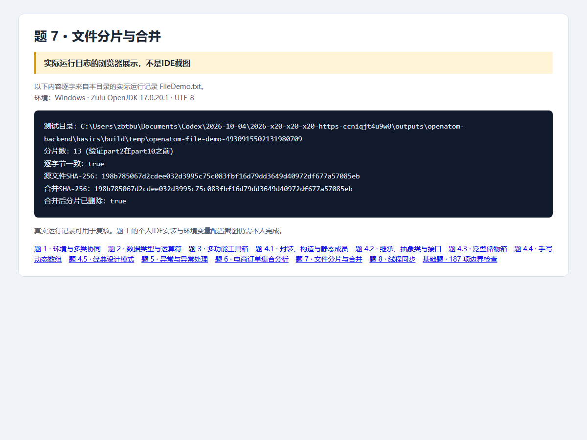

# 第7题：文件分片与合并

题目要求、完整解题过程与面试追问见 [总说明](../../总说明.md)。本目录code为本题可运行源码，screenshots为截图，evidence为原始记录。

## 运行

需要JDK17。在本题目录执行：

```powershell
./code/run.ps1 -Main FileDemo
```

Linux/macOS可在本题目录执行：

```sh
mkdir -p build/classes
javac -encoding UTF-8 --release 17 -d build/classes code/src/openatom/basics/*.java
java -Dfile.encoding=UTF-8 -cp build/classes openatom.basics.FileDemo
```

## 证据来源与完成状态

截图是Java实际运行日志的浏览器展示，不是IDE截图；187项基础检查已复验。



