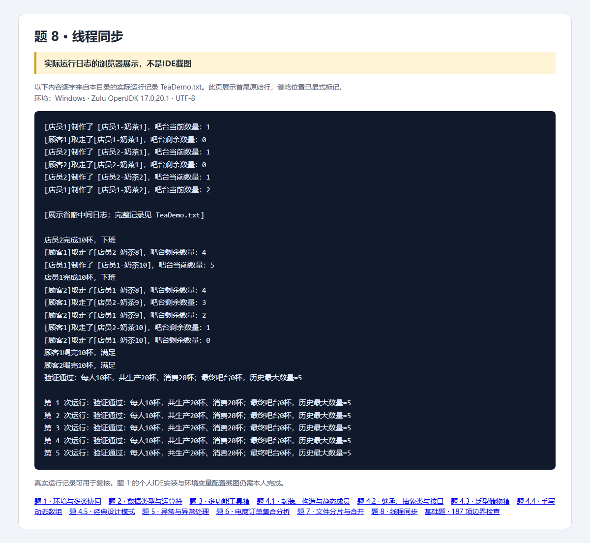

# 第8题：线程同步奶茶店

题目要求、完整解题过程与面试追问见 [总说明](../../总说明.md)。本目录src为唯一源码，screenshots为截图，evidence为本题记录。


## 源码目录与文件

[打开源码目录](src)；下面的链接直接打开源文件，不是截图。

- [TeaCounter.java](src/openatom/basics/TeaCounter.java)
- [TeaCustomer.java](src/openatom/basics/TeaCustomer.java)
- [TeaDemo.java](src/openatom/basics/TeaDemo.java)
- [TeaEmployee.java](src/openatom/basics/TeaEmployee.java)

## 答题过程与代码讲解

**第1步：共享一个吧台，不能各new一个。** 两店员和两顾客都操作同一TeaCounter。队列、统计和容量判断都受同一对象的synchronized保护。

**第2步：满与空都是等待条件。** put满时while(wait)，take空时while(wait)。wait释放吧台锁，其他线程才有机会改变条件；醒来必须重新拿锁，并重新判断。

**第3步：解释一个竞争场景。** 两个顾客都等待，店员放一杯并notifyAll。顾客A先拿锁取走，顾客B拿锁时又空了；while使B继续等待，若用if就可能从空队列取数据。

**第4步：收尾核验。** 每个Runnable循环10次，制作/喝的sleep在锁外。main用join等四人结束，检查各10杯、总生产/消费20、最终0、最大不超过5。

## 本题完整Java源代码

以下逐文件展示实际源码，与源码目录保持一致。每个文件应保持独立，不能把所有public类粘贴到同一个.java里。

### [TeaCounter.java](src/openatom/basics/TeaCounter.java)

```java
package openatom.basics;
import java.util.ArrayDeque;
import java.util.Queue;
public class TeaCounter {
    private final Queue<String> teas = new ArrayDeque<>();
    private final int capacity = 5;
    private int produced;
    private int consumed;
    private int maxObserved;
    public synchronized void put(String employee, String tea) throws InterruptedException {
        while (teas.size() == capacity) wait();
        teas.add(tea); produced++; maxObserved = Math.max(maxObserved, teas.size());
        System.out.println("[" + employee + "]制作了 [" + tea + "]，吧台当前数量：" + teas.size());
        notifyAll();
    }
    public synchronized String take(String customer) throws InterruptedException {
        while (teas.isEmpty()) wait();
        String tea = teas.remove(); consumed++;
        System.out.println("[" + customer + "]取走了[" + tea + "]，吧台剩余数量：" + teas.size());
        notifyAll();
        return tea;
    }
    public synchronized int size() { return teas.size(); }
    public synchronized int getProduced() { return produced; }
    public synchronized int getConsumed() { return consumed; }
    public synchronized int getMaxObserved() { return maxObserved; }
}
```

### [TeaEmployee.java](src/openatom/basics/TeaEmployee.java)

```java
package openatom.basics;
public class TeaEmployee implements Runnable {
    private final TeaCounter counter;
    private final String name;
    private int completed;
    public TeaEmployee(TeaCounter counter, String name) { this.counter = counter; this.name = name; }
    @Override public void run() {
        try {
            for (int i = 1; i <= 10; i++) {
                Thread.sleep(10);
                counter.put(name, name + "-奶茶" + i); completed++;
            }
            System.out.println(name + "完成10杯，下班");
        } catch (InterruptedException exception) { Thread.currentThread().interrupt(); }
    }
    public int getCompleted() { return completed; }
}
```

### [TeaCustomer.java](src/openatom/basics/TeaCustomer.java)

```java
package openatom.basics;
public class TeaCustomer implements Runnable {
    private final TeaCounter counter;
    private final String name;
    private int completed;
    public TeaCustomer(TeaCounter counter, String name) { this.counter = counter; this.name = name; }
    @Override public void run() {
        try {
            for (int i = 0; i < 10; i++) {
                counter.take(name); completed++;
                Thread.sleep(20);
            }
            System.out.println(name + "喝完10杯，满足");
        } catch (InterruptedException exception) { Thread.currentThread().interrupt(); }
    }
    public int getCompleted() { return completed; }
}
```

### [TeaDemo.java](src/openatom/basics/TeaDemo.java)

```java
package openatom.basics;
public class TeaDemo {
    public static void main(String[] args) throws InterruptedException {
        TeaCounter counter = new TeaCounter();
        TeaEmployee first = new TeaEmployee(counter, "店员1"), second = new TeaEmployee(counter, "店员2");
        TeaCustomer alice = new TeaCustomer(counter, "顾客1"), bob = new TeaCustomer(counter, "顾客2");
        Thread[] workers = {new Thread(first), new Thread(second), new Thread(alice), new Thread(bob)};
        for (Thread worker : workers) worker.start();
        try {
            long deadline = System.currentTimeMillis() + 10000;
            for (Thread worker : workers) worker.join(Math.max(1, deadline - System.currentTimeMillis()));
            for (Thread worker : workers) if (worker.isAlive()) throw new IllegalStateException("线程未按时完成");
            if (first.getCompleted() != 10 || second.getCompleted() != 10 || alice.getCompleted() != 10 || bob.getCompleted() != 10
                    || counter.size() != 0 || counter.getProduced() != 20 || counter.getConsumed() != 20 || counter.getMaxObserved() > 5) {
                throw new IllegalStateException("生产消费数量不符合要求");
            }
            System.out.println("验证通过：每人10杯，共生产20杯、消费20杯；最终吧台0杯，历史最大数量=" + counter.getMaxObserved());
        } finally {
            for (Thread worker : workers) if (worker.isAlive()) worker.interrupt();
            for (Thread worker : workers) worker.join();
        }
    }
}
```

## 运行

需要JDK17。在本题目录执行：

```powershell
../../scripts/run-basics.ps1 -Main TeaDemo
```

Linux/macOS可在本题目录执行：

```sh
mkdir -p build/classes
javac -encoding UTF-8 --release 17 -d build/classes src/openatom/basics/*.java
java -Dfile.encoding=UTF-8 -cp build/classes openatom.basics.TeaDemo
```

## 证据来源与完成状态

截图是Java实际运行日志的浏览器展示，不是IDE截图；187项基础检查已复验。



