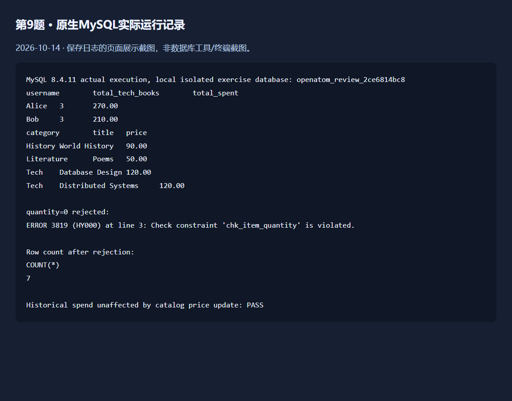

# 第9题：MySQL图书商城查询

题目要求、完整解题过程与面试追问见 [总说明](../../总说明.md)。本目录sql为唯一SQL源码，screenshots为截图，evidence为运行记录。


## 源码目录与文件

[打开源码目录](sql)；下面的链接直接打开源文件，不是截图。

- [01-schema.sql](sql/01-schema.sql)
- [02-seed.sql](sql/02-seed.sql)
- [03-queries.sql](sql/03-queries.sql)
- [04-constraint-check.sql](sql/04-constraint-check.sql)

## 答题过程与代码讲解

**第1步：先建立业务关联。** 订单头属于用户，明细属于订单并指向图书；quantity保存本数，buy_price保存当时成交单价。外键验证关联存在，CHECK验证数量正数。

**第2步：先筛科技，再按用户汇总。** JOIN串联四表，WHERE筛category=Tech，GROUP BY用户，SUM(quantity)是买了几本而非几条明细；SUM(quantity*buy_price)计算历史花费。

**第3步：汇总完才检查三本门槛。** HAVING SUM(quantity)>=3筛组。Alice跨两单加成3本，Bob同一明细买3本；COUNT(*)会把Bob误算成1。

**第4步：最高价查询分两步。** 子查询每类MAX(price)，再JOIN回books得到title。类别和价格都匹配，所以Tech两本同价最高的书均留下。

## 本题完整SQL


### [01-schema.sql](sql/01-schema.sql)

```sql
-- MySQL 8.0.16+; use a fresh exercise database. No DROP statements.
CREATE TABLE users (
    user_id INT AUTO_INCREMENT PRIMARY KEY,
    username VARCHAR(50) NOT NULL UNIQUE
) ENGINE=InnoDB DEFAULT CHARSET=utf8mb4;

CREATE TABLE books (
    book_id INT AUTO_INCREMENT PRIMARY KEY,
    title VARCHAR(100) NOT NULL,
    category VARCHAR(50) NOT NULL,
    price DECIMAL(10,2) NOT NULL,
    stock INT NOT NULL
) ENGINE=InnoDB DEFAULT CHARSET=utf8mb4;

CREATE TABLE orders (
    order_id INT AUTO_INCREMENT PRIMARY KEY,
    user_id INT NOT NULL,
    order_date DATETIME DEFAULT CURRENT_TIMESTAMP,
    total_amount DECIMAL(10,2) NOT NULL,
    FOREIGN KEY (user_id) REFERENCES users(user_id)
) ENGINE=InnoDB DEFAULT CHARSET=utf8mb4;

CREATE TABLE order_items (
    item_id INT AUTO_INCREMENT PRIMARY KEY,
    order_id INT NOT NULL,
    book_id INT NOT NULL,
    quantity INT NOT NULL,
    buy_price DECIMAL(10,2) NOT NULL,
    CONSTRAINT fk_item_order FOREIGN KEY (order_id) REFERENCES orders(order_id),
    CONSTRAINT fk_item_book FOREIGN KEY (book_id) REFERENCES books(book_id),
    CONSTRAINT chk_item_quantity CHECK (quantity > 0),
    CONSTRAINT chk_item_price CHECK (buy_price >= 0)
) ENGINE=InnoDB DEFAULT CHARSET=utf8mb4;
```

### [02-seed.sql](sql/02-seed.sql)

```sql
-- Run once after 01-schema.sql in a fresh exercise database.
START TRANSACTION;
INSERT INTO users (user_id, username) VALUES
    (1, 'Alice'), (2, 'Bob'), (3, 'Charlie'), (4, 'Diana');
INSERT INTO books (book_id, title, category, price, stock) VALUES
    (1, 'Java Basics', 'Tech', 80.00, 100),
    (2, 'Database Design', 'Tech', 120.00, 100),
    (3, 'Distributed Systems', 'Tech', 120.00, 100),
    (4, 'World History', 'History', 90.00, 100),
    (5, 'Ancient History', 'History', 60.00, 100),
    (6, 'Poems', 'Literature', 50.00, 100);
INSERT INTO orders (order_id, user_id, order_date, total_amount) VALUES
    (1, 1, '2026-09-01 10:00:00', 130.00),
    (2, 1, '2026-09-02 10:00:00', 200.00),
    (3, 2, '2026-09-03 10:00:00', 300.00),
    (4, 3, '2026-09-04 10:00:00', 120.00),
    (5, 4, '2026-09-05 10:00:00', 240.00);
INSERT INTO order_items (order_id, book_id, quantity, buy_price) VALUES
    (1, 1, 1, 70.00), (1, 5, 1, 60.00),
    (2, 2, 2, 100.00),
    (3, 1, 3, 70.00), (3, 4, 1, 90.00),
    (4, 5, 2, 60.00),
    (5, 3, 2, 120.00);
COMMIT;
```

### [03-queries.sql](sql/03-queries.sql)

```sql
-- Task 2: quantity counts copies, not distinct titles or order rows.
-- Use the historical purchase price, never the current catalog price.
SELECT u.username,
       SUM(i.quantity) AS total_tech_books,
       SUM(i.quantity * i.buy_price) AS total_spent
FROM users u
JOIN orders o ON o.user_id = u.user_id
JOIN order_items i ON i.order_id = o.order_id
JOIN books b ON b.book_id = i.book_id
WHERE b.category = 'Tech'
GROUP BY u.user_id, u.username
HAVING SUM(i.quantity) >= 3
ORDER BY u.username;

-- Task 3: retain every book tied for the maximum in its category.
SELECT b.category, b.title, b.price
FROM books b
JOIN (
    SELECT category, MAX(price) AS max_price
    FROM books
    GROUP BY category
) highest ON highest.category = b.category AND highest.max_price = b.price
ORDER BY b.category, b.title;
```

### [04-constraint-check.sql](sql/04-constraint-check.sql)

```sql
-- Execute this file separately. The INSERT MUST fail (CHECK violation).
-- Do not use --force: a failure is the expected result, not a passed seed run.
INSERT INTO order_items (order_id, book_id, quantity, buy_price)
VALUES (1, 1, 0, 70.00);
```

## 运行

需要MySQL8.0.16或更新版本；新建练习数据库，在本题目录启动mysql客户端后执行（不要对已有业务库操作）：

```sql
CREATE DATABASE openatom_q09 CHARACTER SET utf8mb4;
USE openatom_q09;
SOURCE sql/01-schema.sql;
SOURCE sql/02-seed.sql;
SOURCE sql/03-queries.sql;
SOURCE sql/04-constraint-check.sql;
```

最后一份quantity=0应被拒绝。已真实执行结果见evidence/mysql-q09.txt：Alice3本270元、Bob3本210元，最高价保留Tech两本并列120元。

## 证据来源与完成状态

第9题已原生MySQL复验通过，日志位于evidence。截图为这份实际日志的页面展示，不是数据库工具或终端截图。此日志不代表Web项目数据库集成完成。



