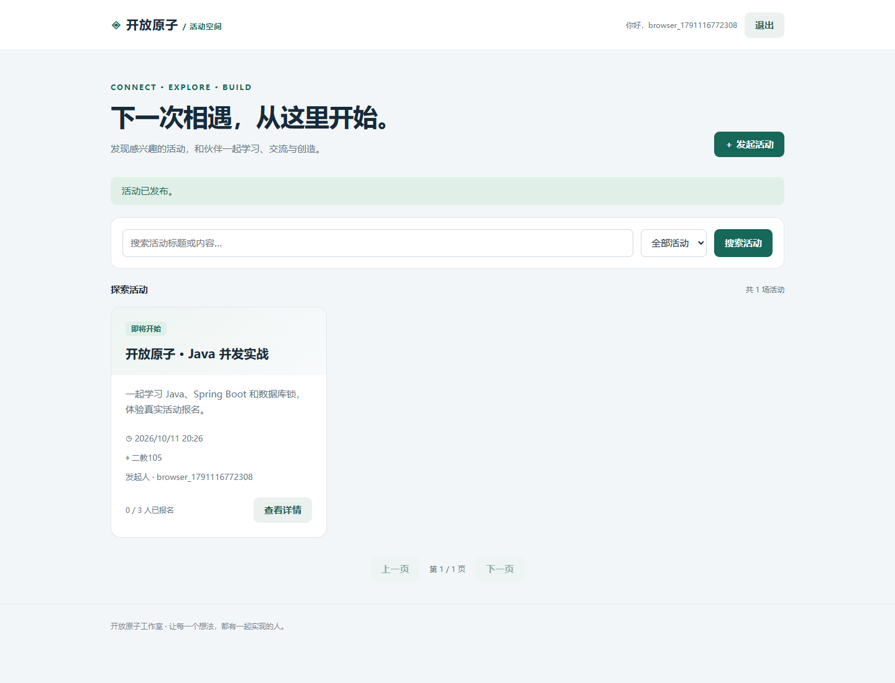
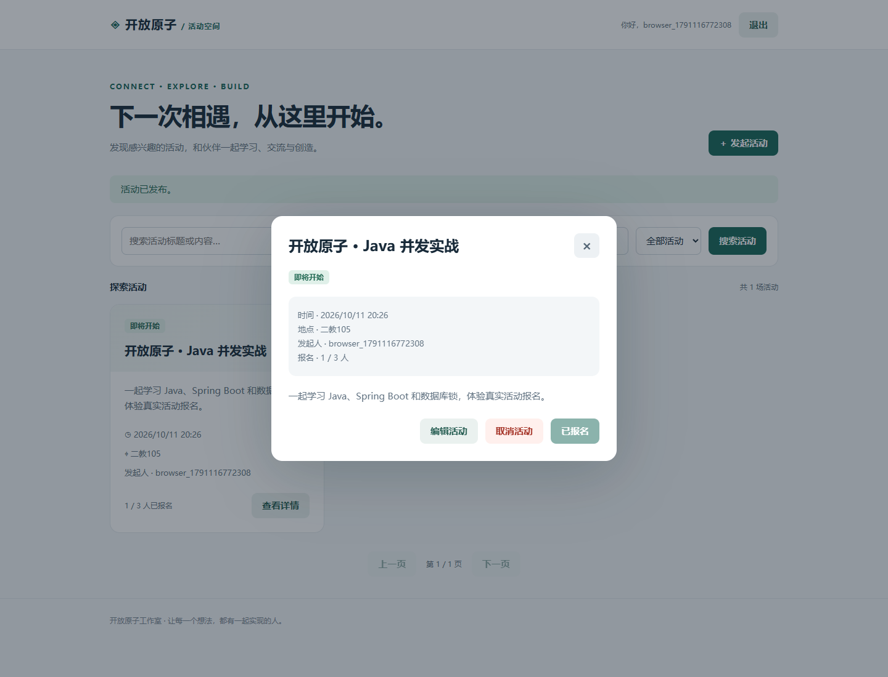

# 第10题：Spring Boot用户认证

题目要求、完整解题过程与面试追问见 [总说明](../../总说明.md)。本题与第11题共用一份 [Web源码](../../shared/web/)，截图与记录链接到仓库evidence。


## 源码目录与文件

[打开源码目录](../../shared/web)；下面的链接直接打开源文件，不是截图。

- [ApiResponse.java](../../shared/web/src/main/java/cn/openatom/events/ApiResponse.java)
- [AuthController.java](../../shared/web/src/main/java/cn/openatom/events/AuthController.java)
- [AuthService.java](../../shared/web/src/main/java/cn/openatom/events/AuthService.java)
- [BusinessException.java](../../shared/web/src/main/java/cn/openatom/events/BusinessException.java)
- [CacheConfig.java](../../shared/web/src/main/java/cn/openatom/events/CacheConfig.java)
- [Event.java](../../shared/web/src/main/java/cn/openatom/events/Event.java)
- [EventApplication.java](../../shared/web/src/main/java/cn/openatom/events/EventApplication.java)
- [EventCacheKey.java](../../shared/web/src/main/java/cn/openatom/events/EventCacheKey.java)
- [EventController.java](../../shared/web/src/main/java/cn/openatom/events/EventController.java)
- [EventListsChanged.java](../../shared/web/src/main/java/cn/openatom/events/EventListsChanged.java)
- [EventNotFoundException.java](../../shared/web/src/main/java/cn/openatom/events/EventNotFoundException.java)
- [EventRepository.java](../../shared/web/src/main/java/cn/openatom/events/EventRepository.java)
- [EventService.java](../../shared/web/src/main/java/cn/openatom/events/EventService.java)
- [GlobalExceptionHandler.java](../../shared/web/src/main/java/cn/openatom/events/GlobalExceptionHandler.java)
- [Registration.java](../../shared/web/src/main/java/cn/openatom/events/Registration.java)
- [RegistrationRepository.java](../../shared/web/src/main/java/cn/openatom/events/RegistrationRepository.java)
- [SecurityConfig.java](../../shared/web/src/main/java/cn/openatom/events/SecurityConfig.java)
- [UnauthorizedAccessException.java](../../shared/web/src/main/java/cn/openatom/events/UnauthorizedAccessException.java)
- [User.java](../../shared/web/src/main/java/cn/openatom/events/User.java)
- [UserRepository.java](../../shared/web/src/main/java/cn/openatom/events/UserRepository.java)
- [BrowserWorkflowTest.java](../../shared/web/src/test/java/cn/openatom/events/BrowserWorkflowTest.java)
- [EventPlatformTest.java](../../shared/web/src/test/java/cn/openatom/events/EventPlatformTest.java)

## 答题过程与代码讲解

**第1步：注册链路。** POST register→Controller校验→AuthService检查用户名与密码字节数→BCrypt哈希→UserRepository保存用户名/哈希/注册时刻。数据库唯一索引处理并发重名，不能只依赖先查不存在。

**第2步：密码登录链路。** POST login传账号密码→查用户→passwords.matches比较→构造JWT。subject是用户ID，issuer是固定发行者，expiresAt是现在加7天；密码不进入JWT。

**第3步：七天免密码如何实现。** 客户端发送Authorization: Bearer token。SecurityFilterChain验证签名、到期、issuer后生成Jwt；Controller发现jwt不为空，调用resume查当前用户并返回原token与原exp，无需账号密码。exp是秒精度，不是每次请求再加7天。

**第4步：为什么能防SQL注入。** Repository按参数查询，输入当数据绑定；用户名规则另限制字符。不能把用户输入直接拼成SQL。参数绑定是核心，输入校验是补充。

## 关键源码与逐步解读

为便于阅读，这里展示关键实现；上方目录链接包含全部实体、接口、配置、测试和页面。
### 对照实际源码

以下展示当前仓库的真实代码。完整文件可直接点击文件名；类内片段依赖所属类的字段、imports及其他方法，不能单独编译。

#### [User.java](../../shared/web/src/main/java/cn/openatom/events/User.java)（完整文件）

```java
package cn.openatom.events;

import jakarta.persistence.*;
import java.time.Instant;

@Entity
@Table(name="app_users", uniqueConstraints=@UniqueConstraint(name="uk_username", columnNames="username"))
public class User {
    @Id @GeneratedValue(strategy=GenerationType.IDENTITY) private Long id;
    @Column(nullable=false, length=50) private String username;
    @Column(name="password_hash", nullable=false, length=100) private String passwordHash;
    @Column(name="registered_at", nullable=false) private Instant registeredAt;
    protected User() {}
    public User(String username, String passwordHash) {
        this.username=username; this.passwordHash=passwordHash; this.registeredAt=Instant.now();
    }
    public Long getId() { return id; }
    public String getUsername() { return username; }
    public String getPasswordHash() { return passwordHash; }
    public Instant getRegisteredAt() { return registeredAt; }
}
```

#### [AuthController.java](../../shared/web/src/main/java/cn/openatom/events/AuthController.java)（完整文件）

```java
package cn.openatom.events;

import jakarta.validation.Valid;
import jakarta.validation.Validator;
import org.springframework.security.core.annotation.AuthenticationPrincipal;
import org.springframework.security.oauth2.jwt.Jwt;
import org.springframework.web.bind.annotation.*;

@RestController
@RequestMapping("/api/auth")
public class AuthController {
    private final AuthService auth;
    private final Validator validator;
    public AuthController(AuthService auth, Validator validator) { this.auth=auth; this.validator=validator; }
    @PostMapping("/register")
    public ApiResponse<Void> register(@Valid @RequestBody AuthService.Credentials body) {
        auth.register(body); return ApiResponse.ok("注册成功",null);
    }
    @PostMapping("/login")
    public ApiResponse<AuthService.AuthResult> login(@AuthenticationPrincipal Jwt jwt,
            @RequestBody(required=false) AuthService.Credentials body) {
        if(jwt!=null) return ApiResponse.ok("登录成功",auth.resume(jwt));
        if(body==null || !validator.validate(body).isEmpty()) throw new BusinessException(400,"请填写合法的用户名和密码");
        return ApiResponse.ok("登录成功",auth.login(body));
    }
}
```

#### [AuthService.java](../../shared/web/src/main/java/cn/openatom/events/AuthService.java)（完整文件）

```java
package cn.openatom.events;

import jakarta.validation.constraints.*;
import java.time.Instant;
import java.time.temporal.ChronoUnit;
import org.springframework.security.crypto.password.PasswordEncoder;
import org.springframework.security.oauth2.jose.jws.MacAlgorithm;
import org.springframework.security.oauth2.jwt.*;
import org.springframework.stereotype.Service;
import org.springframework.transaction.annotation.Transactional;

@Service
public class AuthService {
    public record Credentials(@NotBlank @Pattern(regexp="[A-Za-z0-9_]{3,50}", message="用户名须为3-50位字母、数字或下划线") String username,
                              @NotBlank @Size(min=8,max=72,message="密码长度须为8-72位") String password) {}
    public record AuthResult(String token, Long userId, String username, Instant expiresAt) {}
    private final UserRepository users;
    private final PasswordEncoder passwords;
    private final JwtEncoder encoder;
    public AuthService(UserRepository users, PasswordEncoder passwords, JwtEncoder encoder) {
        this.users=users; this.passwords=passwords; this.encoder=encoder;
    }
    @Transactional
    public void register(Credentials body) {
        if(body.password().getBytes(java.nio.charset.StandardCharsets.UTF_8).length>72)
            throw new BusinessException(400,"密码UTF-8编码不能超过72字节");
        if(users.existsByUsername(body.username())) throw new BusinessException(409,"用户名已存在");
        users.saveAndFlush(new User(body.username(), passwords.encode(body.password())));
    }
    public AuthResult login(Credentials body) {
        User user=users.findByUsername(body.username()).orElseThrow(()->new BusinessException(401,"用户名或密码错误"));
        if(!passwords.matches(body.password(),user.getPasswordHash())) throw new BusinessException(401,"用户名或密码错误");
        Instant now=Instant.now(), expiry=now.plus(7,ChronoUnit.DAYS);
        JwtClaimsSet claims=JwtClaimsSet.builder().issuer("openatom-events").subject(user.getId().toString())
                .issuedAt(now).expiresAt(expiry).claim("username",user.getUsername()).build();
        String token=encoder.encode(JwtEncoderParameters.from(JwsHeader.with(MacAlgorithm.HS256).build(),claims)).getTokenValue();
        return new AuthResult(token,user.getId(),user.getUsername(),expiry);
    }
    public AuthResult resume(Jwt jwt) {
        User user=users.findById(Long.parseLong(jwt.getSubject())).orElseThrow(()->new BusinessException(401,"用户已不存在"));
        // Preserve original expiry: returning to login must not extend the seven-day window.
        return new AuthResult(jwt.getTokenValue(),user.getId(),user.getUsername(),jwt.getExpiresAt());
    }
}
```

#### [SecurityConfig.java](../../shared/web/src/main/java/cn/openatom/events/SecurityConfig.java)（完整文件）

```java
package cn.openatom.events;

import com.nimbusds.jose.jwk.source.ImmutableSecret;
import com.fasterxml.jackson.databind.ObjectMapper;
import javax.crypto.spec.SecretKeySpec;
import java.nio.charset.StandardCharsets;
import java.time.Duration;
import org.springframework.beans.factory.annotation.Value;
import org.springframework.context.annotation.*;
import org.springframework.http.HttpMethod;
import org.springframework.security.config.annotation.web.builders.HttpSecurity;
import org.springframework.security.config.http.SessionCreationPolicy;
import org.springframework.security.crypto.bcrypt.BCryptPasswordEncoder;
import org.springframework.security.crypto.password.PasswordEncoder;
import org.springframework.security.oauth2.jose.jws.MacAlgorithm;
import org.springframework.security.oauth2.jwt.*;
import org.springframework.security.web.SecurityFilterChain;

@Configuration
public class SecurityConfig {
    @Bean PasswordEncoder passwordEncoder() { return new BCryptPasswordEncoder(); }
    @Bean SecretKeySpec jwtKey(@Value("${app.jwt-secret}") String secret) {
        byte[] bytes=secret.getBytes(StandardCharsets.UTF_8);
        if(bytes.length<32) throw new IllegalStateException("JWT_SECRET must contain at least 32 UTF-8 bytes");
        return new SecretKeySpec(bytes,"HmacSHA256");
    }
    @Bean JwtEncoder encoder(SecretKeySpec key) { return new NimbusJwtEncoder(new ImmutableSecret<>(key)); }
    @Bean JwtDecoder decoder(SecretKeySpec key) {
        NimbusJwtDecoder decoder=NimbusJwtDecoder.withSecretKey(key).macAlgorithm(MacAlgorithm.HS256).build();
        JwtTimestampValidator time=new JwtTimestampValidator(Duration.ZERO);
        decoder.setJwtValidator(new org.springframework.security.oauth2.core.DelegatingOAuth2TokenValidator<>(
                time, new JwtIssuerValidator("openatom-events"), jwt -> {
                    if(jwt.getExpiresAt()==null || !jwt.getSubject().matches("[0-9]+"))
                        return org.springframework.security.oauth2.core.OAuth2TokenValidatorResult.failure(
                                new org.springframework.security.oauth2.core.OAuth2Error("invalid_token"));
                    return org.springframework.security.oauth2.core.OAuth2TokenValidatorResult.success();
                }));
        return decoder;
    }
    @Bean SecurityFilterChain security(HttpSecurity http, ObjectMapper json) throws Exception {
        var entry=(org.springframework.security.web.AuthenticationEntryPoint)(request,response,e)->{
            response.setStatus(401); response.setContentType("application/json;charset=UTF-8");
            json.writeValue(response.getWriter(),ApiResponse.error(401,"请登录，或登录凭证已过期"));
        };
        return http.csrf(x->x.disable()).sessionManagement(x->x.sessionCreationPolicy(SessionCreationPolicy.STATELESS))
                .authorizeHttpRequests(x->x.requestMatchers("/","/index.html","/error","/favicon.ico").permitAll()
                        .requestMatchers(HttpMethod.POST,"/api/auth/register","/api/auth/login").permitAll()
                        .requestMatchers(HttpMethod.GET,"/api/events","/api/events/*").permitAll()
                        .anyRequest().authenticated())
                .oauth2ResourceServer(x->x.jwt(j->{}).authenticationEntryPoint(entry))
                .exceptionHandling(x->x.authenticationEntryPoint(entry).accessDeniedHandler((req,res,e)->{
                    res.setStatus(403); res.setContentType("application/json;charset=UTF-8");
                    json.writeValue(res.getWriter(),ApiResponse.error(403,"无权访问"));
                })).build();
    }
}
```

## 运行

JDK17+Maven。在仓库根目录运行同一份项目：

```sh
mvn -f shared/web/pom.xml verify
mvn -f shared/web/pom.xml spring-boot:run
```

浏览器访问 http://localhost:8080 。默认H2+Caffeine。完整MySQL+Redis配置见 [Web运行说明](../../shared/web/README.md)；Compose在仓库根目录执行。第10题重点是认证，第11题重点是活动与报名；两题共用代码，不重复存放。

## 证据来源与完成状态

旧Web截图来自真实Spring MockMvc浏览器流程，不是Docker截图；六组集成测试和14项真实HTTP检查通过，但测试使用H2+Caffeine。Web MySQL+Redis、Docker实际运行证据待补。







