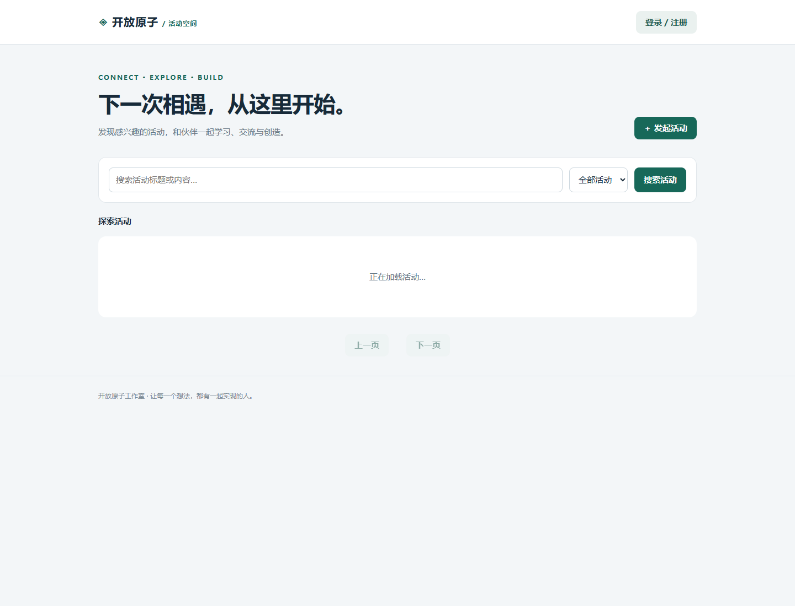
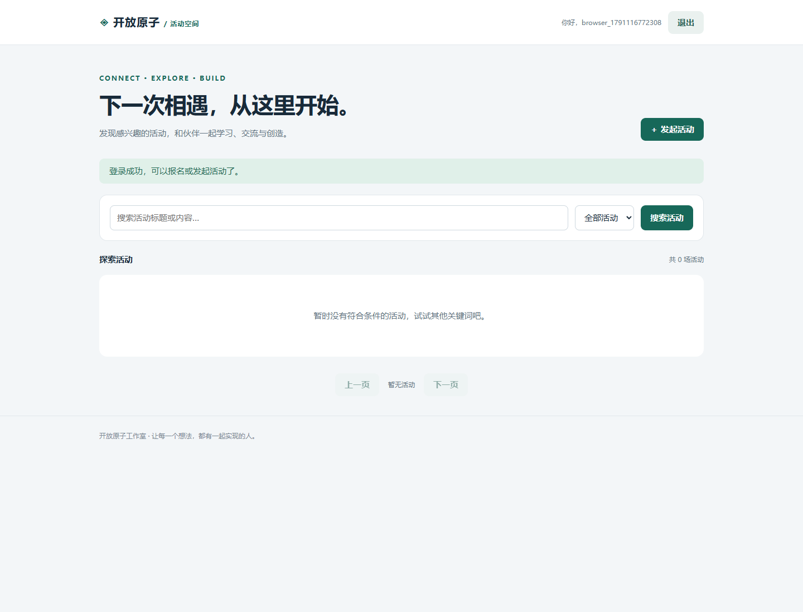
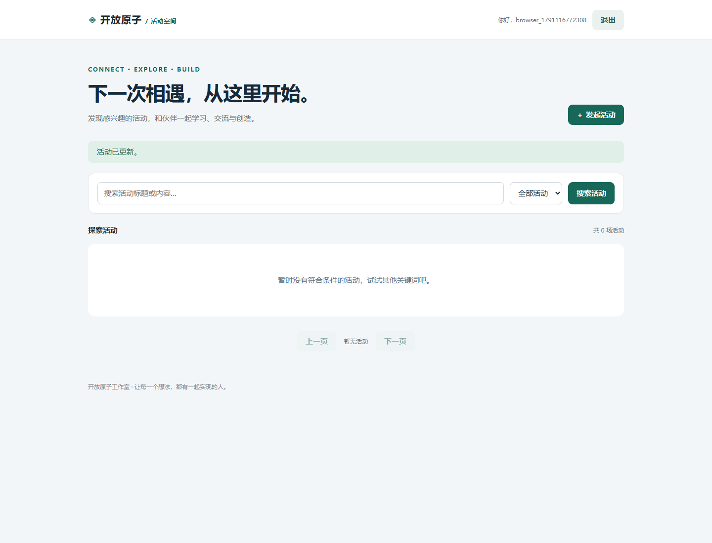
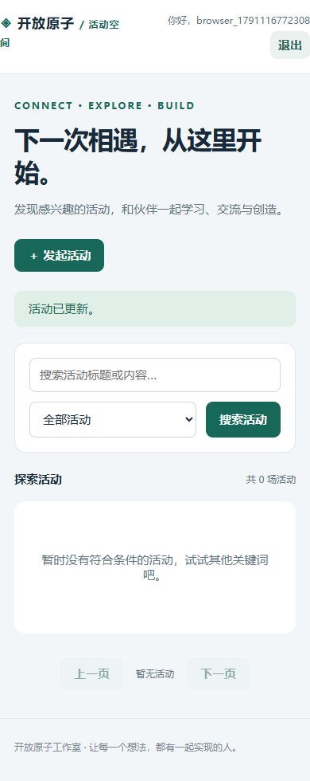

# 第11题：线上活动报名系统

题目要求、完整解题过程与面试追问见 [总说明](../../总说明.md)。本目录code为本题可运行源码，screenshots为截图，evidence为原始记录。

## 运行

JDK17+Maven；在本题目录执行：

```sh
mvn -f code/web/pom.xml verify
mvn -f code/web/pom.xml spring-boot:run
```

浏览器访问 http://localhost:8080 。默认H2+Caffeine，真实MySQL+Redis部署步骤见 [Web说明](code/web/README.md)，Compose应在code目录运行。第10、11题共享模块，均保留完整项目以保证运行；本题重点分别是认证/活动报名。

## 证据来源与完成状态

旧Web截图来自真实Spring MockMvc浏览器流程，不是Docker截图；六组集成测试和14项真实HTTP检查通过，但测试使用H2+Caffeine。Web MySQL+Redis、Docker实际运行证据待补。










